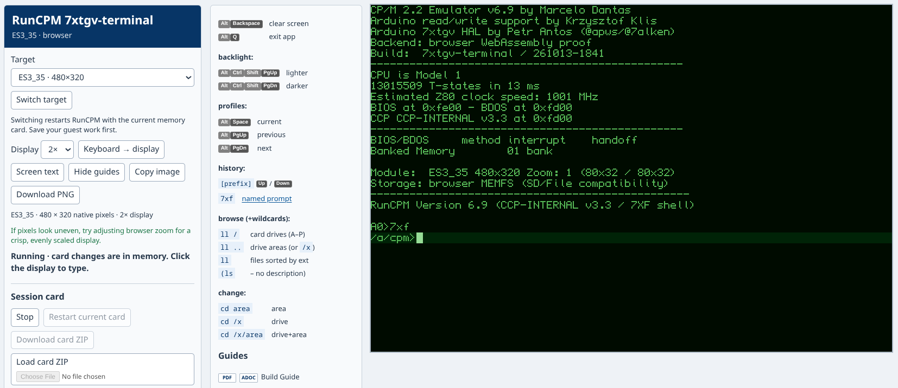

= RunCPM 7xtgv-terminal
:source-highlighter: highlight.js
:leveloffset: +2
:experimental:

*https://apws.github.io/261007-RunCPM-7xtgv-terminal/[Try it in your browser]* --
run CP/M, explore its applications and try the terminal's colors, graphics,
history and profiles. No installation, physical board or external terminal is
needed. Start with the link:guides/02-UG-user-guide.adoc#browser-session[short browser introduction].

[.mx-fullwidth]

[cols="1a,1a",frame=none,grid=none,stripes=none]
|===
|The C++ RunCPM and terminal run locally in your browser as WebAssembly,
using the project's Arduino_GFX drawing code and six selectable display
configurations. The same terminal also runs on small MCU/TFT boards and in
native SDL windows on Linux and Windows.

This is a working development and experimental tool for *7xtgv-native --
Tiled GUI Video engine*: a fast, low-power, keyboard-driven cell engine with
a GUI-like look and feel. Today's RunCPM/VT/ANSI terminal is its testbed;
the native engine is not yet implemented.

|
[.mx-fullwidth]
image::guides/images/desktop-xterm256.png[CP/M Mandelbrot graphics in the ES3_5 desktop emulator,width=100%]

The ES3_5 board configuration running a CP/M xterm-256 Mandelbrot demo on desktop.
|===

== First browser session

Wait for the CP/M prompt, click the display and type `VTINFO`, then press
kbd:[Enter]. Try `7XF` followed by `LS /` to explore the cataloged drive/user
areas. The link:guides/02-UG-user-guide.adoc#browser-session[User Guide] explains
target selection, display scale and the next things to try.

*Keep your work:* save inside the CP/M application, use *Stop*, then
*Download card ZIP*. Closing or reloading the page discards changes you have
not downloaded. A guest save alone does not make the browser card persistent.

Use a current desktop browser. Linux Chromium has automated coverage;
macOS has only a limited Intel MacBook Air user check, with keyboard differences.
See link:guides/02-UG-user-guide.adoc#browser-compatibility[browser and MacBook notes].
The emulated display does not reproduce MCU speed, physical panel response,
bus timing or electrical behavior.

== Build and run

[[_1_set_up_your_machine]][[_linux]][[_windows]][[_2_open_your_boards_launcher_folder]][[_3_try_the_desktop_or_connect_real_hardware]]Choose the route that matches what you want to do:

[cols="1,3",options="header"]
|===
|Route |Start here
|Native desktop on Linux or Windows |link:guides/01-BG-build-guide.adoc#quick-start[Build Guide: setup, rebuild, launch]. Type into the native mirror; SDL is output-only. The selected host card is read/write and changes persist there.
|Physical MCU/TFT module |link:guides/01-BG-build-guide.adoc#hardware-workflow[Build Guide: hardware]. Linux tooling builds firmware with `rebuild.sh` and uploads it with `reflash.sh`. Firmware and CP/M card preparation are separate.
|Build or host the browser application |link:src/RunCPM_7xtgv-terminal/tools-web/README.adoc[Browser tooling]. One shared Wasm build supports all six displays; the page selects the target. Visiting the published application does not require these tools.
|===

The link:guides/01-BG-build-guide.adoc#supported-modules[board table] links
Waveshare and Guition modules and their documentation. Native desktop builds
use `desktop-rebuild`; they do not create or flash MCU firmware. Native macOS
launchers remain unimplemented; this does not prevent using the browser route.

== Guides and docs (AsciiDoc)

Start with the maintained guides:

* link:guides/01-BG-build-guide.adoc[Build Guide]: setup and recovery details.
* link:guides/02-UG-user-guide.adoc[User Guide]: everyday keys, commands and examples.
* link:guides/03-RG-reference-guide.adoc[Reference Guide]: exact controls, settings and protocols.
* link:guides/04-TRG-technical-reference-guide.adoc[Technical Reference Guide]: architecture, developer tests and feature tracking.
* link:guides/05-TG-tooling-guide.adoc[Tooling Guide]: host launch paths, mirror ownership, builds and transfers.
* link:guides/06-HG-history-guide.adoc[History Guide]: detailed raw origins and development reconstruction for personal review, with source descriptions and public references.
* link:guides/README.adoc[Guide index] and link:docs/README.adoc[technical document index]:
  further reading, plans and dated findings.

=== Optional local AsciiDoc viewing

For formatted local viewing in *Chrome or Chromium*, install
https://chromewebstore.google.com/detail/asciidoctorjs-live-previe/iaalpfgpbocpdfblpnhhgllgbdbchmia[Asciidoctor.js Live Preview]
from the Chrome Web Store. Enable *Allow access to file URLs* in the extension's
Details page, then open a local `.adoc` file.
The https://docs.asciidoctor.org/browser-extension/install/[official installation guide]
also documents Edge support; Edge has not been tested here.

For the project's appearance and working cross-document anchor jumps, select
these root-level files in the extension options:

* link:asciidoctorjs-crx-mixworx.css[asciidoctorjs-crx-mixworx.css]: custom stylesheet.
* link:asciidoctorjs-crx-mixworx.js[asciidoctorjs-crx-mixworx.js]: custom JavaScript;
  choose execution *after the document has been rendered*. Splits guide titles
  into two lines locally and restores anchor jumps. Re-select this file in the
  extension options when updating the helper; GitHub keeps the normal
  colon-separated title.

== Repository layout

[cols="1,3",options="header"]
|===
|Path |Contents
|link:src/RunCPM_7xtgv-terminal/README.md[`src/RunCPM_7xtgv-terminal/`] |Active firmware, SDL desktop, board HALs and host tools
|link:src/RunCPM_linux/README.md[`src/RunCPM_linux/`] |POSIX CP/M comparator used by developer tests; not the SDL terminal
|link:src/legacy/README.adoc[`src/legacy/`] |Historical demos and display bring-up projects
|`build/` |Generated build output; ignored by Git
|link:cpmcard/README.adoc[`cpmcard/`] |Complete versioned working card, including settings/history and snapshots
|link:guides/README.adoc[`guides/`] |Maintained user, reference, technical and build guides
|link:docs/README.adoc[`docs/`] |Chronological plans/checkpoints, feature ledger, recovery notes and reference material
|`backups/` |Local generated backups; ignored by Git
|`private/`, `docs/private/` |Local-only material; ignored by Git and absent from a fresh clone
|===

== Licensing

The original *7xtgv-terminal software is MIT-licensed*, for hardware and
desktop alike. See link:LICENSING.adoc[license scope] and
link:LICENSE[the MIT license]. The native 7xtgv specification
in `docs/` is outside this grant. Independently licensed components and
imported CP/M packages retain their own terms; see
link:THIRD_PARTY_NOTICES.md[third-party notices and remaining review items].

== Thank you, Ari (OpenAI Codex CLI)

All this work would have been impossible without my implementation and
consulting colleague Ari. +
A big thank you! :-)
footnote:[Ari is my name for the OpenAI Codex assistant. Perhaps thanking an AI
colleague is a little unusual -- but the appreciation is genuine.]

image::guides/images/codex-ari-september.png[Codex token activity during the September development sessions,width=900]
