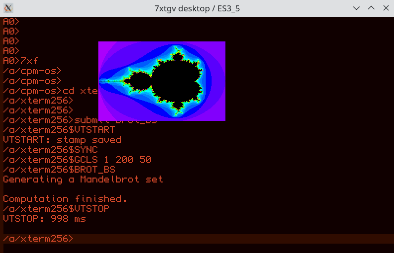
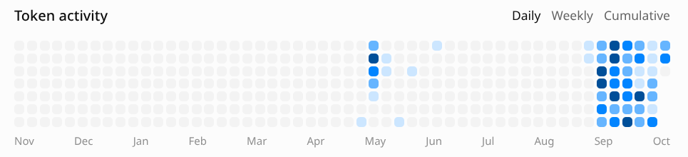

= RunCPM 7xtgv-terminal
:source-highlighter: highlight.js
:leveloffset: +2

[cols="1a,1a",frame=none,grid=none,stripes=none]
|===
|Run a CP/M machine on a small MCU/TFT board -- or run the same terminal
firmware in a desktop window on *Linux or Windows*. The native SDL emulator uses the real
Arduino_GFX drawing code and the selected board's display configuration,
not a separate imitation of its screen.

Use the PC mirror for keyboard input and a complete view of the logical
terminal; the TFT or SDL window shows the board-sized, zoomable and pannable
display. Try CP/M applications, colors, graphics, history and profiles
without needing the physical module on your desk.

This is a working development and experimental tool for *7xtgv-native --
Tiled GUI Video engine*: a fast, low-power, keyboard-driven cell engine with
a GUI-like look and feel. Today's RunCPM/VT/ANSI terminal is its testbed,
not the completed native engine.

|
[.mx-fullwidth]

The ES3_5 board configuration running a CP/M xterm-256 Mandelbrot demo on desktop.
|===

The experimental link:src/RunCPM_7xtgv-terminal/tools-web/README.adoc[browser version]
runs the C++ terminal and RunCPM in one shared WebAssembly build for all six
displays. Use the common `tools-web/desktop-local.sh` launcher, then select the
target inside the page. Keyboard input, text/image copying and card ZIP
import/export are built in; no external terminal is needed. See the linked
README for web setup, rebuilding and hosting requirements.

The same board definitions drive hardware and desktop: display geometry,
zoom/pan, palettes, profiles, rendering policy and backlight controls.
SDL simulates backlight brightness; physical panel response, bus timing,
CPU speed and electrical behavior are not reproduced exactly.
Supported modules use RP2350, ESP32-S3, ESP32-P4 and ESP32-C6.

== Build and run

The desktop workflow is the same on both hosts: *setup, rebuild, then launch*.
Linux uses `tools/` and `.sh` scripts; Windows uses `tools-win/` and matching
`.cmd` launchers. Linux remains the hardware build/upload environment.
Windows desktop builds use MSYS2 UCRT64; WSL is not required.

=== 1. Set up your machine

==== Linux

From the cloned repository directory, run setup as your normal user:

[source,sh]
----
./src/RunCPM_7xtgv-terminal/tools/setup.sh
----

The script detects *Arch-based*, *Debian-based* and *Fedora-based* distributions. It installs system prerequisites, Arduino CLI,
pinned board cores/libraries and desktop C++/CMake/SDL2 tools.
It asks before installation, uses sudo where needed, and offers USB serial
group access separately. It does not build or flash anything.

Use `./src/RunCPM_7xtgv-terminal/tools/setup.sh --dry-run` to preview it
without installing. Arch-family use has been exercised; real fresh-machine
Debian/Fedora installation remains to be verified. See the
link:guides/01-BG-build-guide.adoc[Build Guide] for cloning,
prerequisites and troubleshooting.

==== Windows

a. Clone or extract the repository to a writable local folder, for example
   `C:\work\7xtgv`. A clone requires an existing Git client; a source ZIP can
   be extracted without Git. Generated executables are not included.
b. Install x64 https://www.msys2.org/[MSYS2], for example in `C:\msys64`.
   Our setup reuses this installation; it does not install MSYS2 itself.
c. Open that installation's *UCRT64* terminal (`C:\msys64\ucrt64.exe`) and run
   `pacman -Syu`. If prompted to close its processes, accept, reopen UCRT64
   and repeat the update to completion. See the
   https://www.msys2.org/docs/updating/[full-update instructions].
d. In Explorer or *Windows Command Prompt*, run
   `src\RunCPM_7xtgv-terminal\tools-win\setup.cmd` from the checkout.
   It installs the compiler, build tools and mirror prerequisites into MSYS2,
   plus Arduino_GFX sources under the project's `build/` directory.
   No Windows PATH change or Arduino MCU-core installation is needed.

The launcher prints the selected MSYS2 directory. For a custom location, use
`set "XTGV_MSYS2_ROOT=D:\path\to\msys64"` in Command Prompt before setup.
Use the same installation for the update and setup. Both C: and D: installations
are supported. Detailed requirements and recovery steps are in the
link:guides/01-BG-build-guide.adoc#windows-setup[Build Guide] and
link:src/RunCPM_7xtgv-terminal/tools-win/README.adoc[Windows tooling notes].
macOS launchers remain unimplemented.

=== 2. Open your board's launcher folder

Choose the launcher parent for your host:

* Linux: link:src/RunCPM_7xtgv-terminal/tools/targets/[`src/RunCPM_7xtgv-terminal/tools/targets/`].
* Windows: link:src/RunCPM_7xtgv-terminal/tools-win/targets/[`src/RunCPM_7xtgv-terminal/tools-win/targets/`].

Both contain the same folders named `++DISPLAY_ID -- target++`:

[cols="1,1,3",options="header"]
|===
|Vendor |Display ID |Folder under the full path above
|WAVESHARE |`EC6_147` |`++EC6_147 -- esp32c6-lcd-1-47++`
|GUITION |`EP4_10` |`++EP4_10 -- jc8012p4a1c++`
|GUITION |`ES3_35` |`++ES3_35 -- jc8048w535++`
|GUITION |`ES3_5` |`++ES3_5 -- jc8048w550++`
|WAVESHARE |`RP2_147` |`++RP2_147 -- rp2350-lcd-1-47-a++`
|WAVESHARE |`RP2_2` |`++RP2_2 -- rp2350-touch-lcd-2++`
|===

For example, on Linux:

[source,sh]
----
cd "src/RunCPM_7xtgv-terminal/tools/targets/EP4_10 -- jc8012p4a1c"
----

Run `.sh` scripts in a Linux terminal; on Windows, double-click the `.cmd`
launcher or run it from Command Prompt. Each script already selects
its board. Build/upload and desktop shortcuts show short status messages
with detailed logs beside the scripts; `mirror.sh` attaches directly.

[cols="2,2,5",options="header"]
|===
|Linux |Windows |Action
|`desktop-rebuild.sh` |`desktop-rebuild.cmd` |Builds the selected board's desktop emulator. No hardware access.
|`desktop-local.sh` |`desktop-local.cmd` |Launches its last build with repository `cpmcard/` and a mirror.
|`desktop-card.sh` |`desktop-card.cmd` |Launches its last build with a selected external card and a mirror. Use `--card-root PATH`.
|`rebuild.sh` |-- |Builds and stages firmware for the physical board. Does not flash.
|`reflash.sh` |-- |Uploads staged `new` firmware, falling back to `current`, then opens the mirror. Does not rebuild.
|`mirror.sh` |-- |Opens the mirror for the connected physical board. No build or flash.
|===

=== 3. Try the desktop, or connect real hardware

For a first desktop run, execute these separately in the selected board folder.
On Linux:

[source,sh]
----
./desktop-rebuild.sh
./desktop-local.sh
----

On Windows, in Command Prompt (or double-click each launcher in that order):

[source,bat]
----
desktop-rebuild.cmd
desktop-local.cmd
----

The SDL window is the emulated display; *type into the mirror*, not SDL.
Use the same terminal commands and keyboard controls as on the physical
board, including zoom, palettes and backlight. Closing the owning mirror
or SDL window stops the desktop session.

For a mounted card, run `./desktop-card.sh` and enter the mount path,
or supply it explicitly, for example:

[source,sh]
----
./desktop-card.sh --card-root "/run/media/$USER/RunCPM"
----

On Windows, pass the card root in Command Prompt, for example:

[source,bat]
----
desktop-card.cmd --card-root "E:\"
----

Use your actual drive letter. The card root must contain `A/0`.
On Linux, `XTGV_DESKTOP_CARD_ROOT` is an alternative to supplying the path.
Both desktop launchers use their selected card *read/write*, including
INI and history updates. Do not run two writers against the same card;
close the emulator before unmounting it.

For physical hardware, use `rebuild.sh`, then `reflash.sh`.
RP2350 boards need BOOTSEL mode; ESP32 normally uploads over its running
serial connection. Missing-device prompts guide connection; target or
ambiguous-device errors must be resolved, not bypassed.

After changing source, rebuild before launching or reflashing: launchers
do not silently rebuild. More options are in the
link:src/RunCPM_7xtgv-terminal/desktop/README.adoc[desktop guide] and
link:guides/01-BG-build-guide.adoc[Build Guide].

== Guides and docs (AsciiDoc)

For formatted local viewing in *Chrome or Chromium*, install
https://chromewebstore.google.com/detail/asciidoctorjs-live-previe/iaalpfgpbocpdfblpnhhgllgbdbchmia[Asciidoctor.js Live Preview]
from the Chrome Web Store. Enable *Allow access to file URLs* in the extension's
Details page, then open a local `.adoc` file.
The https://docs.asciidoctor.org/browser-extension/install/[official installation guide]
also documents Edge support; Edge has not been tested here.

For the project's appearance and working cross-document anchor jumps, select
these root-level files in the extension options:

* link:asciidoctorjs-crx-mixworx.css[asciidoctorjs-crx-mixworx.css]: custom stylesheet.
* link:asciidoctorjs-crx-mixworx.js[asciidoctorjs-crx-mixworx.js]: custom JavaScript;
  choose execution *after the document has been rendered*. Splits guide titles
  into two lines locally and restores anchor jumps. Re-select this file in the
  extension options when updating the helper; GitHub keeps the normal
  colon-separated title.

Start with the maintained guides:

* link:guides/01-BG-build-guide.adoc[Build Guide]: setup and recovery details.
* link:guides/02-UG-user-guide.adoc[User Guide]: everyday keys, commands and examples.
* link:guides/03-RG-reference-guide.adoc[Reference Guide]: exact controls, settings and protocols.
* link:guides/04-TRG-technical-reference-guide.adoc[Technical Reference Guide]: architecture, developer tests and feature tracking.
* link:guides/05-TG-tooling-guide.adoc[Tooling Guide]: host launch paths, mirror ownership, builds and transfers.
* link:guides/06-HG-history-guide.adoc[History Guide]: the project's beginnings and motivations; in preparation.
* link:guides/README.adoc[Guide index] and link:docs/README.adoc[technical document index]:
  further reading, plans and dated findings.

== Repository layout

[cols="1,3",options="header"]
|===
|Path |Contents
|link:src/RunCPM_7xtgv-terminal/README.md[`src/RunCPM_7xtgv-terminal/`] |Active firmware, SDL desktop, board HALs and host tools
|link:src/RunCPM_linux/README.md[`src/RunCPM_linux/`] |POSIX CP/M comparator used by developer tests; not the SDL terminal
|link:src/legacy/README.adoc[`src/legacy/`] |Historical demos and display bring-up projects
|`build/` |Generated build output; ignored by Git
|link:cpmcard/README.adoc[`cpmcard/`] |Complete versioned working card, including settings/history and snapshots
|link:guides/README.adoc[`guides/`] |Maintained user, reference, technical and build guides
|link:docs/README.adoc[`docs/`] |Chronological plans/checkpoints, feature ledger, recovery notes and reference material
|`backups/` |Local generated backups; ignored by Git
|`private/`, `docs/private/` |Local-only material; ignored by Git and absent from a fresh clone
|===

== Licensing

The original *7xtgv-terminal software is MIT-licensed*, for hardware and
desktop alike. See link:LICENSING.adoc[license scope] and
link:LICENSE[the MIT license]. The native 7xtgv specification
in `docs/` is outside this grant. Independently licensed components and
imported CP/M packages retain their own terms; see
link:THIRD_PARTY_NOTICES.md[third-party notices and remaining review items].

== Thank you, Ari (OpenAI Codex CLI)

All this work would have been impossible without my implementation and
consulting colleague Ari. +
A big thank you! :-)
footnote:[Ari is my name for the OpenAI Codex assistant. Perhaps thanking an AI
colleague is a little unusual -- but the appreciation is genuine.]

