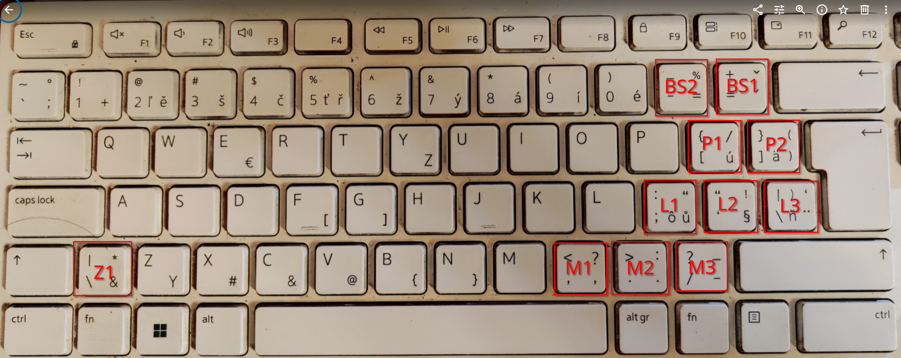

= CZ KBD layout keys to detect+override using these IDc -- Screenshot_20260919_180409
:source-highlighter: highlight.js

Czech keyboard physical positions used in the terminal key-override design. Red labels identify the proposed key positions.

