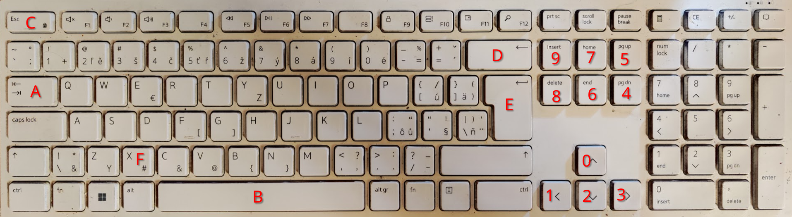

= 7xtgv KBD CORE KEYS CONTROL  -- Screenshot_20260921_180114
:leveloffset: +2
:source-highlighter: highlight.js

7xtgv core-key layout: red hexadecimal labels identify the sixteen low-nibble positions. The F assignment remained a design choice.

