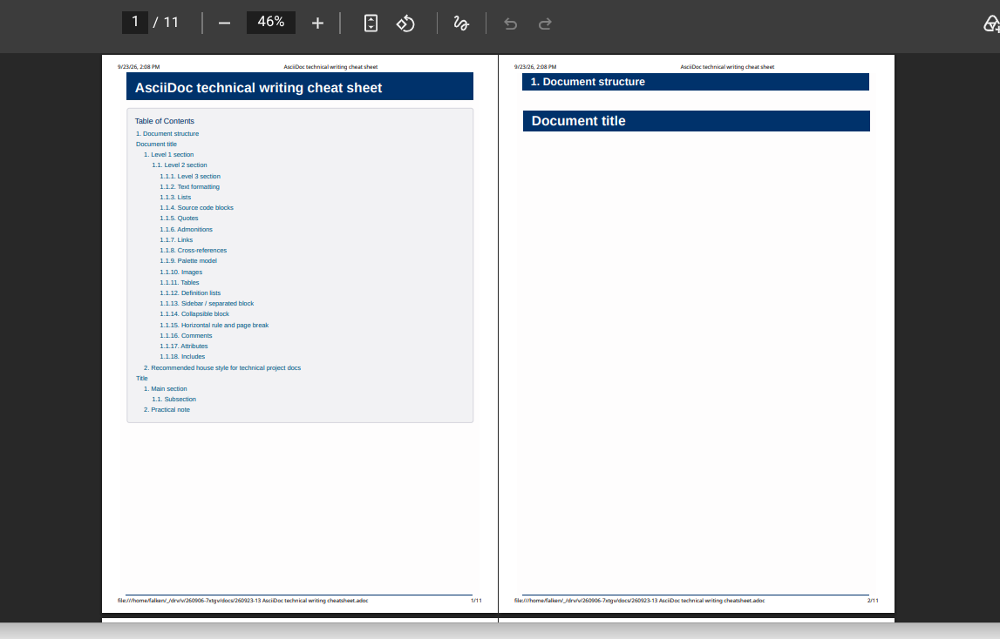
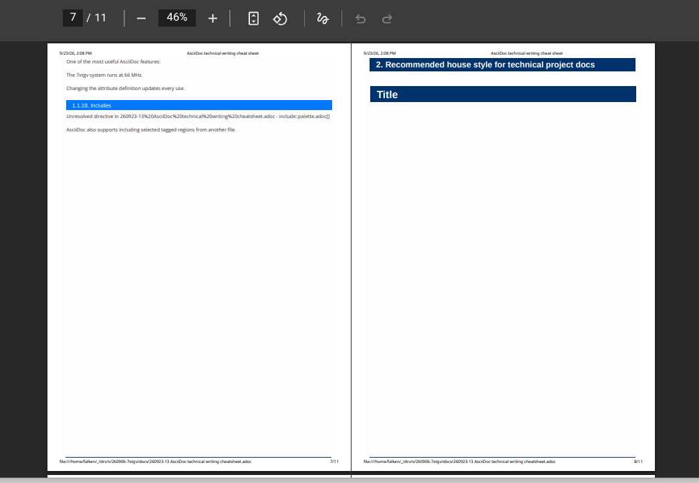
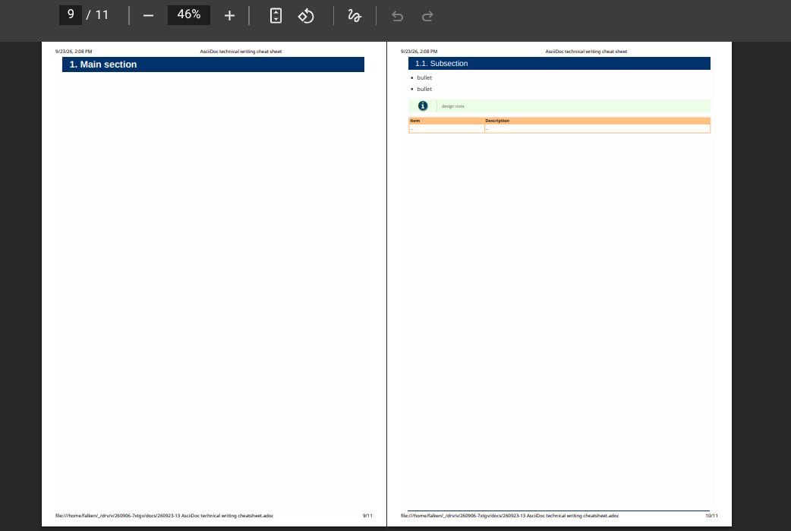
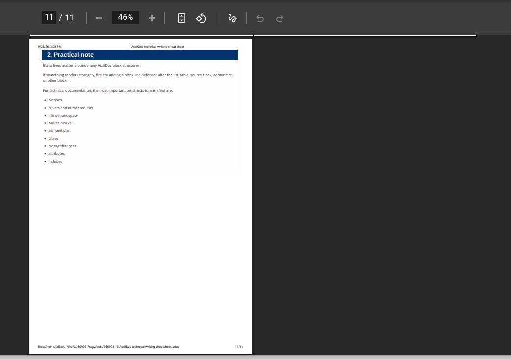

= AsciiDoc technical writing cheat sheet
//:leveloffset: +1
:toclevels: 3
:toc:
:sectnums:
:source-highlighter: highlight.js

:project-example: 7xtgv
:cpu-clock-example: 66 MHz

== Document structure

= Document title
:toc:
:sectnums:
:source-highlighter: highlight.js

== Level 1 section

=== Level 2 section

==== Level 3 section

==== Text formatting

*bold*

_italic_

`monospace`

#marked/highlighted text#

Inline code / literals:

Use `mode_palette=` in the `[global]` section.

==== Lists

Bullets:

* first item
* second item
** nested item
** another nested item
*** deeper

Numbered list:

. first
. second
.. nested
.. nested
. third

For unordered lists, standardize on `*` rather than Markdown-style `-`, because nesting is very clear.

==== Source code blocks

[source,ini]
----
[palette0]

; comment
paper0 = RGB565
paper1 = RGB565 R
----

Other languages:

[source,c]
----
printf("hello\n");
----

[source,bash]
----
grep -R "palette" .
----

[source,verilog]
----
always @(posedge clk)
    q <= d;
----

Plain literal block without syntax highlighting:

....
literal text
preserves spacing
....

==== Quotes

[quote]
____
Some quoted text.
____

==== Admonitions

Very useful for technical notes:

NOTE: This is a note.

TIP: Useful hint.

WARNING: Important warning.

CAUTION: Something potentially dangerous.

IMPORTANT: Do not forget this.

Multi-paragraph admonition:

[NOTE]
====
This can contain several paragraphs.

And even lists or source blocks.
====

==== Links

https://example.com

https://example.com[Example site]

==== Cross-references

[[palette-model]]

==== Palette model

See <<palette-model>>.

With custom link text:

See <<palette-model,the palette model>>.

==== Tables

Simple table:

|===
| Field | Meaning | Status

| mode_palette
| Select active palette
| implemented

| mode_attr
| Attribute interpretation
| planned
|===

With header row and column widths:

[cols="1,3,1",options="header"]
|===
| Field | Meaning | Status

| mode_palette
| Active palette selection
| done
|===

==== Images

.example alone

===== images in table, side by side

[cols="1a,1a",frame=none,grid=none]
|===
|
.TOC image

|
.Top-level paging
image::images/cheatsheet2.png[width=400]

|
.In-page sections
image::images/cheatsheet3.png[width=400]
|
.Document content

|
.End and new Top level doc, paging

|
.End note

|===

==== Definition lists

Excellent for configuration/reference documentation:

mode_palette:: Selects palette mode.
mode_attr:: Selects attribute interpretation.
paper0:: Default background color.

==== Sidebar / separated block

.Optional design note
****
This is visually separated from the main text.
****

==== Collapsible block

Supported by renderers that implement collapsible blocks:

[%collapsible]
====
Hidden details here.
====

==== Horizontal rule and page break

Horizontal rule:

'''

Page break:

<<<

==== Comments

Single-line comment:

// single-line comment

Block comment:

////
This is not rendered.
Useful for internal notes.
////

==== Attributes

One of the most useful AsciiDoc features:

:project: 7xtgv
:cpu-clock: 66 MHz

The {project} system runs at {cpu-clock}.

Changing the attribute definition updates every use.

==== Includes

include::260923-08 VTPAL INI sections.adoc[]

AsciiDoc also supports including selected tagged regions from another file.

== Recommended house style for technical project docs

:leveloffset: +3

= Title
:toc:
:toclevels: 6
:sectnums:
:source-highlighter: highlight.js

== Main section

=== Subsection

* bullet
* bullet

NOTE: design note

[cols="1,3",options="header"]
|===
| Item | Description
| ...
| ...
|===

== Practical note

Blank lines matter around many AsciiDoc block structures.

If something renders strangely, first try adding a blank line before or after the list, table, source block, admonition, or other block.

For technical documentation, the most important constructs to learn first are:

* sections
* bullets and numbered lists
* inline monospace
* source blocks
* admonitions
* tables
* cross-references
* attributes
* includes

:leveloffset: -3
== Tweaking notes

// -----------------------------------------------------------------------------
// Notes added after the original cheat sheet was created.
// Each topic stays at ==== level. The body text is intentionally smaller in
// HTML/Chromium preview; headings keep their normal document styling.
// -----------------------------------------------------------------------------

++++

++++

==== TOC depth without changing heading styling

[.post-cheatsheet-note]
--
The depth of the generated table of contents is independent of the visible heading styling.

Use, for example:

[source,asciidoc]
----
:toc:
:toclevels: 4
----

This keeps the actual section levels and CSS styling unchanged, but includes headings down to that depth in the TOC.

`toclevels` controls only how deep the TOC goes. It does _not_ shift the actual section hierarchy.

`leveloffset` is a different feature. It changes the effective section levels, mainly useful for included documents:

[source,asciidoc]
----
include::chapter.adoc[leveloffset=+1]
----
--

==== Explicit page breaks and Chromium/PDF printing

[.post-cheatsheet-note]
--
The native AsciiDoc page-break marker is:

[source,asciidoc]
----
<<<
----

With Asciidoctor PDF this is intended as a real page break.

When rendering through Asciidoctor.js to HTML and then printing from Chromium, the final behavior is controlled by print CSS. A useful rule is:

[source,css]
----
@media print {
    .pagebreak {
        break-before: page;
        page-break-before: always;
    }
}
----

Useful related print rules:

[source,css]
----
@media print {
    h1, h2, h3, h4, h5, h6 {
        break-after: avoid-page;
        page-break-after: avoid;
    }

    pre,
    table,
    .admonitionblock,
    .sidebarblock,
    .listingblock,
    .literalblock {
        break-inside: avoid-page;
        page-break-inside: avoid;
    }
}
----

This helps prevent headings or compact blocks from being stranded awkwardly across printed pages.
--

==== Side-by-side images

[.post-cheatsheet-note]
--
Normal block images are placed one below another.

A simple and reliable way to make an image gallery is an AsciiDoc table. The important detail is the `a` column style, which tells Asciidoctor to parse the cell contents as full AsciiDoc:

[source,asciidoc]
....
[cols="1a,1a",frame=none,grid=none]
|===
|
.TOC image

|
.Top-level paging
image::images/cheatsheet2.png[width=100%]

|
.In-page sections
image::images/cheatsheet3.png[width=100%]

|
.Document content

|===
....

Without the `a`, an expression such as `image::...[]` may be rendered literally as cell text instead of being interpreted as an image macro.

Inside table cells, `width=100%` is usually preferable to a fixed pixel width because the table column already determines the available width.
--

==== Image captions inside AsciiDoc table cells

[.post-cheatsheet-note]
--
A block title such as `.TOC` must be on its own line immediately before the image macro.

Correct:

[source,asciidoc]
----
|
.TOC

----

Do not write the title and image on the same cell line:

[source,asciidoc]
----
|.TOC image::images/cheatsheet1.png[width=100%]
----

The latter is not interpreted as a normal image block title/caption.
--

==== Browser preview and source highlighting are separate systems

[.post-cheatsheet-note]
--
Kate syntax highlighting and Chromium/Asciidoctor.js preview highlighting are independent.

For browser-rendered source highlighting, keep this document attribute:

[source,asciidoc]
----
:source-highlighter: highlight.js
----

Then use native AsciiDoc source blocks:

[source,asciidoc]
....
[source,ini]
----
[palette0]

; comment
paper0 = RGB565
----
....

Kate may use KDE's KSyntaxHighlighting grammar for the `.adoc` source, while the browser preview uses `highlight.js` for the contents of `[source,LANG]` blocks.
--

==== Kate nested INI highlighting inside AsciiDoc

[.post-cheatsheet-note]
--
Stock Kate can highlight the AsciiDoc document itself, but its stock AsciiDoc syntax definition may treat source-block contents as generic verbatim text instead of delegating `[source,ini]` to KDE's INI grammar.

A user-local KSyntaxHighlighting override can add an INI source-block context using the existing KDE grammar, conceptually:

[source,xml]
----
<IncludeRules context="##INI Files" includeAttrib="true"/>
----

Keep the override user-local rather than modifying packaged files directly.

The separate Codex implementation plan documents this customization in detail.
--

==== Comments are invisible by design

[.post-cheatsheet-note]
--
A live comment example cannot demonstrate itself in the rendered document because comments intentionally disappear from output.

Single-line comment syntax:

[source,asciidoc]
----
// single-line comment
----

Block comment syntax:

[source,asciidoc]
----
////
This is not rendered.
Useful for internal notes.
////
----

Use source blocks for cheat-sheet examples of constructs whose purpose is to vanish from the rendered result.
--

==== Attributes and includes in a live cheat sheet

[.post-cheatsheet-note]
--
Some constructs are better shown as source rather than executed live.

Attributes are normally defined in the document header:

[source,asciidoc]
----
:project: 7xtgv
:cpu-clock: 66 MHz

The {project} system runs at {cpu-clock}.
----

An include directive executes immediately:

[source,asciidoc]
----
include::palette.adoc[]
----

Therefore, if the referenced file does not exist, a live example produces an unresolved-include warning. In a cheat sheet, show such an include inside a source block unless the example file really exists.
--
