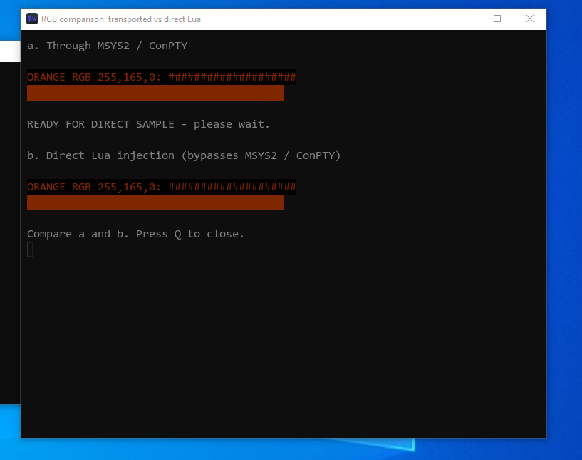

= REJECT: WezTerm colours in VirtualBox Windows 10
:source-highlighter: highlight.js
:experimental:
:toc:
:toclevels: 2

== Decision and scope

On 261012, Petr requests removal of the experimental WezTerm integration and
retention of the AsciiDoc records. The practical replacement of the existing
host terminals is rejected for the tested setup: Windows 10 LTSC in VirtualBox,
with WezTerm `20240203-110809-5046fc22` and Mesa SVGA3D `24.0.2` reported in
its startup logs. This is not a claim that WezTerm fails on every Windows host.
The exact cause remains unresolved; no further investigation is planned.

Continue using Konsole/Kitty on Linux and Mintty on Windows. Their unified
host keyboard configuration, including `XTGV_HACK_TOPROW`, remains supported.
There is no need for a new terminal to retain that shared policy.

Earlier records remain historical evidence:

* link:261011-2229%20DONE%20WezTerm%20desktop%20integration%20feasibility.adoc[Feasibility investigation].
* link:261011-2243%20DONE%20Separate%20WezTerm%20local%20launchers.adoc[Experimental launchers and initial acceptance].

== Observed colour failure

The native Windows ES3_35 experiment starts RunCPM, accepts `DIR`, and renders
both the SDL display and WezTerm mirror. The mirror's colours differ visibly
from SDL: the initial screenshot shows purple mirror text against amber SDL
text. Later isolated tests display requested RGB `255,165,0` as a very dark
orange/brown. Default text is unusually dark; the original cursor is magenta.

The Linux WezTerm check (`20260716-195552-76b606ec`) displays the expected orange.
This comparison spans different WezTerm versions, operating systems and graphics
stacks. It does not isolate a particular version, programming language, driver
or operating-system component as the cause.

== Bounded experiments and results

a. Adding `front_end = 'Software'` to a temporary generated Windows Lua profile
   produces the same visible result as the original frontend. The Windows log
   still reports OpenGL context initialization and fallback. The result does
   not prove that every graphics-driver or compositor stage was bypassed.
b. A separate configuration based on
   https://gist.github.com/rulasfia/47134c9e71ba24dfe96cf701f4c52fbb[rulasfia's Windows configuration]
   uses its Vesper palette and WebGPU. Consolas replaces the external Nerd Font;
   Windows 11 Mica is omitted for Win10. The window fails to open with:
+
[source,text]
----
Failed to create window: Limit 'max_compute_workgroups_per_dimension' value 65535 is better than allowed 0
----
+
   Switching that temporary configuration to OpenGL allows it to open. The
   palette changes default text/cursor appearance, but the explicit orange
   remains too dark. This combined appearance test retains the gist's 0.8
   background opacity; it is not a one-variable colour diagnosis.
c. A single-window comparison sends the same 144-byte RGB sample through two
   routes: MSYS2 Bash/ConPTY, then direct WezTerm Lua `pane:inject_output`.
   Both visibly produce the same dark orange. The direct route bypasses the
   external terminal-output transport for that sample.
d. WezTerm's reconstructed cell-attribute capture preserves the requested RGB
   values in both samples:
+
[source,text]
----
Foreground: ESC [ 38:2::255:165:0 m
Background: ESC [ 48:2::255:165:0 m
----
+
   The result record reports `both_samples_displayed`, frontend `OpenGL`,
   144 sample bytes and Windows WezTerm `20240203-110809-5046fc22`.
   This is a reconstruction of terminal-cell attributes, not a raw wire capture.
   It establishes that the requested colour reaches WezTerm's terminal model
   through both tested routes. It provides no evidence of RGB-number corruption
   in MSYS2/ConPTY for this sample. Rendering, compositing and display-stack
   interpretation remain unisolated possibilities.

.User screenshot: identical dark samples through the transport and direct Lua injection

The temporary direct-comparison script initially failed because a non-login
MSYS Bash lacked `/usr/bin` in PATH. Setting PATH inside the test script fixed
that harness error before the successful comparison above. This startup error
was unrelated to the colour result.

== Cleanup and retained work

Removed the experimental Linux/Windows `local-wezterm` launchers, shared Lua
profile generator, WezTerm-specific tests and frontend branches, temporary RGB
launchers, generated profiles and disposable test artifacts. Reviewed tracked
host-code changes return to their pre-experiment committed implementation.
Current guides point to this rejected experiment rather than offering removed
launch commands. Installed WezTerm applications and user-global configurations
are not uninstalled or changed.

All AsciiDoc records are retained, including the two temporary test READMEs.
The keycap authoring convention and accepted shared CSS are kept: compact
white labels on dark grey caps, aligned with prose, with no visible plus sign
or gap inside a chord. Source macros keep their original keyboard semantics.
The document-style preview is separate from the retired terminal experiment.

The working card INI/history and unrelated modifications are preserved.
A Windows session still reports `running` in its old status file and the card
lock remains present, despite Petr reporting normal closure. Its session files
and the lock are preserved pending confirmation of the actual owner state;
cleanup does not forcibly stop or unlock a card writer.

No commit, push, firmware rebuild or deployment is part of this cleanup.

== Cleanup verification

a. 52 existing tooling tests pass after removing the WezTerm branches.
b. Six shared host-key setting tests and three Windows local-snapshot tests pass.
c. Source search finds no remaining WezTerm references in executable tooling or
   tests. The feature registry validates all 212 records; whitespace checks pass.
d. All nine reviewed tracked host-code/ignore files match their pre-experiment
   committed versions. This is host tooling cleanup; no hardware is built or
   flashed by these checks.

== Later card-lock recovery on 261012

Petr subsequently shut down the Windows VM and removed the leftover card lock.
VM shutdown establishes that its emulator is no longer writing. The lock is
absent on the host; the working card INI and history remain preserved.

== References

* https://wezterm.org/config/lua/config/front_end.html[WezTerm frontend settings].
* https://wezterm.org/config/lua/pane/inject_output.html[Direct pane output injection].
* https://wezterm.org/config/lua/pane/get_lines_as_escapes.html[Cell-attribute reconstruction].
