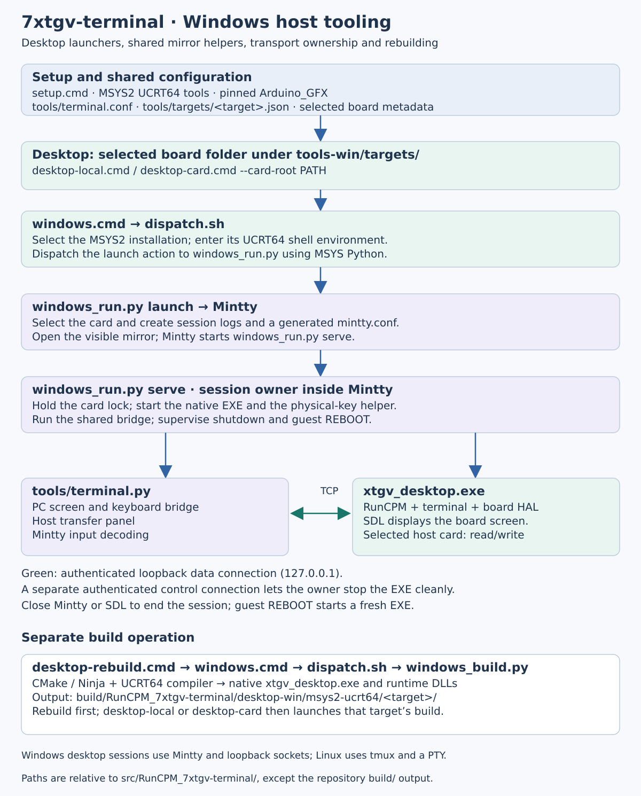

= RunCPM 7xtgv-terminal: Tooling Guide
:leveloffset: +1
:source-highlighter: highlight.js
:toc:
:toclevels: 3
:sectnums!:

The host tools select a board, build or upload its firmware, and connect a PC
terminal window to either hardware or the desktop emulator. This guide maps
those responsibilities and the files which connect them. Use the
link:01-BG-build-guide.adoc[Build Guide] for setup and executable launch recipes,
and the link:03-RG-reference-guide.adoc[Reference Guide] for keyboard and transfer syntax.

Native desktop emulation is buildable on Linux and Windows. Both use the
same workflow: explicit setup, `desktop-rebuild`, then `desktop-local` or
`desktop-card`. Linux launchers are under `tools/targets/` with `.sh` extensions;
Windows launchers are under `tools-win/targets/` with `.cmd` extensions.
The terminal/CP/M behavior is shared; host mirror and process transport differ.
Hardware build/upload remains a Linux workflow. For first installation, use
the link:01-BG-build-guide.adoc#quick-start[Build Guide's setup steps].

Paths below are relative to `src/RunCPM_7xtgv-terminal/`.

[[tooling-structure]]
== 1. Structure at a glance

Both hosts use the same desktop operations: rebuild, launch with the repository
card, or launch with a selected external card. These diagrams show how each
host connects those operations to the emulator and its mirror.

=== Linux host tooling

image::images/tooling-structure.svg[Linux hardware and desktop tooling structure,width=1200]

=== Windows host tooling

Blue arrows show launch flow. Green arrows show the bidirectional connection
between the bridge and CP/M. Maintenance/build boxes summarize separate
operations; they are not additional stages of an ordinary mirror launch.
Both hosts use `terminal.py` and the shared terminal protocol. Transport and
process details are described in
link:04-TRG-technical-reference-guide.adoc#desktop-host-tooling[TRG: desktop host tooling].

[[tooling-names]]
== 2. Names and their roles

[cols="2,3",options="header"]
|===
|Name |Role
|`tools/cpm-session.sh` |Shell helper which creates or attaches to a tmux session, starts the bridge and handles attachment cleanup. This is a script filename.
|`7xtgv-terminal` |Default hardware tmux session name. The same spelling identifies the Konsole profile and keyboard table, but those are separate objects.
|`tools/7xtgv-terminal.profile` |Konsole appearance/interaction settings. Its visible name is `7xtgv-terminal`; `KeyBindings=7xtgv-terminal` selects the keyboard table.
|`tools/7xtgv-terminal.keytab` |Konsole keyboard table. It converts host chords into terminal key events and control sequences; application-specific interpretation is configured by the guest INI.
|`tools/kon.sh` |Installs the profile and a configuration-specific generated keytab into the user's Konsole data directory, opens Konsole and invokes `cpm-session.sh`.
|`tools/kit.sh` |Generates a configuration-specific copy of `tools/kitty.conf` in the host cache, opens Kitty with it and invokes the same `cpm-session.sh`.
|`7xtgv-desktop-<PID>` |Isolated desktop tmux session name. The desktop launcher supplies it through `XTGV_SESSION`, replacing the hardware default for that process.
|`tools/terminal.py` |PC mirror/bridge. Exchanges bytes with the MCU serial endpoint, Linux desktop PTY or Windows loopback endpoint and handles mirror controls and the host transfer panel.
|===

Konsole installs the two files under
`${XDG_DATA_HOME:-$HOME/.local/share}/konsole/` on each `kon.sh` launch.
Selecting a Konsole profile does not select an application bank. The firmware
or desktop terminal resolves bank settings from the selected card's
`A0:7XTGVTRM.INI`.

`tools/generate_key_events.py` maintains the generated key-event blocks in
`7xtgv-terminal.keytab`, `kitty.conf` and `kitty-cpm.conf`. Those host mappings
and the terminal decoder must agree on event encoding. Normal `kon.sh`/`kit.sh`
launches generate separate copies using the current host configuration; they
leave the checked-in templates and existing windows unchanged. Konsole selects
`7xtgv-terminal-<content-hash>.keytab` through a launch override. Kitty uses a
content-specific file under `${XDG_CACHE_HOME:-~/.cache}/7xtgv-terminal/`.

[[hardware-tooling-path]]
== 3. Hardware mirror and ownership

. The selected board folder's `mirror.sh` invokes `tools/target_mirror.py` with
  the board's canonical target name.
. `target_config.py` loads `tools/targets/<target>.json` and resolves the serial
  endpoint. Launcher defaults and overrides also use `tools/terminal.conf`.
. `target_mirror.py` chooses Konsole, Kitty or the current terminal and invokes
  `kon.sh`, `kit.sh` or `cpm-session.sh` respectively.
. `cpm-session.sh` attaches to the existing shared `7xtgv-terminal` session,
  or creates it and starts `terminal.py`. The bridge is the serial reader;
  extra windows attach to tmux instead of opening another serial connection.

The creating mirror attachment owns session cleanup. Its exit terminates the
host bridge; the MCU continues running CP/M. `cpm-session.sh --monitor` creates
an observing attachment without that owning cleanup path.

The shell helper accepts `XTGV_SESSION` as an override. The hardware reflash
and INI-fetch helpers operate on the standard `7xtgv-terminal` session, so
custom hardware session names require corresponding lifecycle coordination.
Desktop launchers supply their own isolated session explicitly.

[[desktop-tooling-path]]
== 4. Desktop launch and ownership

Use the same three operations in the chosen target folder on either host:
`desktop-rebuild` builds, `desktop-local` opens the repository's `cpmcard/`, and
`desktop-card --card-root PATH` opens a selected external card. Add `.sh` on
Linux or `.cmd` on Windows. Setup and first-run commands are in the
link:01-BG-build-guide.adoc[Build Guide].

=== Linux desktop mirror

a. Run `desktop-local.sh` or `desktop-card.sh --card-root PATH` from the target
   folder under `tools/targets/`.
b. The launcher starts the selected emulator and opens Konsole, Kitty or the
   current terminal as its mirror.
c. Type CP/M commands into the mirror; the SDL window shows the board display.
d. Close the owning mirror or SDL window to end the session. Guest `REBOOT`
   restarts the emulator.

=== Windows desktop mirror

a. Run `desktop-local.cmd` or `desktop-card.cmd --card-root PATH` from the target
   folder under `tools-win/targets/`.
b. The launcher starts the selected emulator and opens Mintty as its mirror.
c. Type CP/M commands into the mirror; the SDL window shows the board display.
d. Close the owning mirror or SDL window to end the session. Guest `REBOOT`
   restarts the emulator.

=== Shared session controls

Both launch modes open their selected card read/write, including guest files,
INI and history. A per-card lock prevents another participating desktop from
opening the same card for writing. Close the session before removing the card.

Both hosts accept `--window-scale N` (integer 1..9, default 1). For example,
`desktop-local.sh --window-scale 3` or `desktop-local.cmd --window-scale 3`
shows the entire fixed-size SDL panel at triple size. This is independent of
terminal glyph zoom and does not change guest geometry or the INI.

*Alt+Q* is application exit in the supplied Konsole, Kitty and Mintty profiles.
Bank, brightness and zoom controls use the shared terminal mappings in the
link:03-RG-reference-guide.adoc#global-terminal-keys[Reference Guide].
`XTGV_HACK_TOPROW` in `tools/terminal.conf` controls optional number-row conversion;
open a new mirror after changing it. Keyboard implementation and configuration
precedence are described in
link:04-TRG-technical-reference-guide.adoc#desktop-host-tooling[TRG: desktop host tooling].

=== Choosing the Linux mirror

The default `--mirror auto` checks for a graphical session (`DISPLAY` or
`WAYLAND_DISPLAY`), then chooses Konsole if it is on PATH, otherwise Kitty.
If neither is available, or there is no graphical session, it uses the current
terminal. With both installed, Konsole wins; the choice does not depend on
which terminal launched the script.

Choose explicitly for a session:

[source,sh]
----
./desktop-local.sh --mirror konsole
# Or choose Kitty instead:
./desktop-local.sh --mirror kitty
----

`desktop-card.sh` and the hardware `mirror.sh` accept the same option.
`--mirror terminal` uses the current terminal. An explicitly requested missing
terminal produces an error; it does not silently select another.
Konsole has been the primary interactive Linux test path. Kitty has a supplied
integration and configuration checks, with less physical-key/user testing;
availability does not imply equal acceptance coverage. Windows uses Mintty.

See link:04-TRG-technical-reference-guide.adoc#desktop-host-tooling[TRG]
for process ownership, transports and platform-specific launcher options, and
the link:../src/RunCPM_7xtgv-terminal/tools-win/README.adoc[Windows tooling notes]
for logs and diagnostic commands.

=== Retired WezTerm experiment

The optional WezTerm launchers were removed on 261012 after Windows colour
tests. Use Konsole/Kitty on Linux and Mintty on Windows; the shared host
keyboard configuration remains supported. Historical findings are retained
in link:../docs/261012-0001%20REJECT%20WezTerm%20colours%20in%20VirtualBox%20Windows%2010.adoc[the retirement record].

[[tooling-maintenance]]
== 5. Builds, uploads and transfers

[cols="2,3",options="header"]
|===
|Entry point |Path and effect
|`rebuild.sh` |`target_reflash.py --build-only` delegates to `reflash.py --build-only`. Builds/stages the selected MCU target under `build/`; does not stop the mirror or upload.
|`reflash.sh` |`target_reflash.py --upload-only` selects staged firmware, stops the standard hardware mirror, uploads through `reflash.py` for serial targets or `bootsel_upload.py` for RP2350, then restores the selected visible mirror. Upload restarts the MCU and loses guest application state.
|`desktop-rebuild.cmd` |`windows.cmd` / `dispatch.sh` delegates to `windows_build.py` and CMake in MSYS2 UCRT64. Produces the native Windows EXE and adjacent runtime DLLs; launch is separate.
|`desktop-rebuild.sh` |`target_desktop.py build` delegates to `desktop.py build` and CMake. Produces a host executable; launch remains a separate operation.
|Guest `VTPUT` / `VTGET` |The running mirror opens its transfer panel; `terminal.py` loads `tools/cpm-transfer/transfer.py` and uses the existing connection. No second serial reader is opened.
|Direct `tools/cpm-transfer/transfer.py` |Owns its direct connection. Stop the hardware mirror first and restore its visible attachment afterward.
|`tools/fetch-7xtgvtrm-ini.sh` |Stops the standard hardware mirror, downloads device `A0:7XTGVTRM.INI`, archives the preceding local copy, then restores the Konsole mirror. This fetch does not upload the INI.
|`tools-win/setup.cmd` |Explicit Windows prerequisite setup in the selected MSYS2 installation, plus project-local GFX sources. Run the full MSYS2 update separately first.
|`tools/setup.sh` |Explicit Linux prerequisite installation and host setup. Rebuild/launch tools report missing prerequisites rather than installing them implicitly.
|===

After a tooling-name update, close a hardware mirror started by the previous
version before launching its replacement. A different tmux session name does
not free a serial endpoint already owned by an older bridge. Existing Konsole
windows retain their loaded profile; new `kon.sh` launches install/select the
current profile. Old installed profiles can remain until no longer needed.

For terminal/core/HAL source ownership, see the
link:04-TRG-technical-reference-guide.adoc#source-references-and-implementation-boundaries[Technical Reference Guide].

