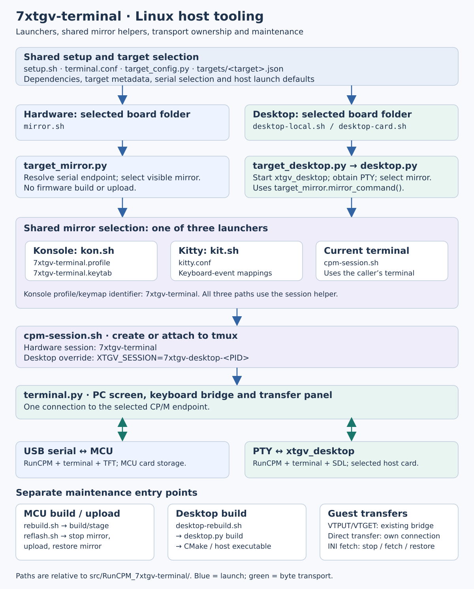

= RunCPM 7xtgv-terminal: Tooling Guide
:leveloffset: +1
:source-highlighter: highlight.js
:toc:
:toclevels: 3
:sectnums!:

The host tools select a board, build or upload its firmware, and connect a PC
terminal window to either hardware or the desktop emulator. This guide maps
those responsibilities and the files which connect them. Use the
link:01-BG-build-guide.adoc[Build Guide] for setup and executable launch recipes,
and the link:03-RG-reference-guide.adoc[Reference Guide] for keyboard and transfer syntax.

Paths below are relative to `src/RunCPM_7xtgv-terminal/`.

[[tooling-structure]]
== 1. Structure at a glance

Blue arrows show launch flow. Green arrows show the bidirectional connection
between the bridge and CP/M. The three maintenance boxes summarize separate
operations; they are not additional stages of an ordinary mirror launch.

[[tooling-names]]
== 2. Names and their roles

[cols="2,3",options="header"]
|===
|Name |Role
|`tools/cpm-session.sh` |Shell helper which creates or attaches to a tmux session, starts the bridge and handles attachment cleanup. This is a script filename.
|`7xtgv-terminal` |Default hardware tmux session name. The same spelling identifies the Konsole profile and keyboard table, but those are separate objects.
|`tools/7xtgv-terminal.profile` |Konsole appearance/interaction settings. Its visible name is `7xtgv-terminal`; `KeyBindings=7xtgv-terminal` selects the keyboard table.
|`tools/7xtgv-terminal.keytab` |Konsole keyboard table. It converts host chords into terminal key events and control sequences; application-specific interpretation is configured by the guest INI.
|`tools/kon.sh` |Installs the profile and a configuration-specific generated keytab into the user's Konsole data directory, opens Konsole and invokes `cpm-session.sh`.
|`tools/kit.sh` |Generates a configuration-specific copy of `tools/kitty.conf` in the host cache, opens Kitty with it and invokes the same `cpm-session.sh`.
|`7xtgv-desktop-<PID>` |Isolated desktop tmux session name. The desktop launcher supplies it through `XTGV_SESSION`, replacing the hardware default for that process.
|`tools/terminal.py` |PC mirror/bridge. Exchanges bytes with the MCU serial endpoint, Linux desktop PTY or Windows loopback endpoint and handles mirror controls and the host transfer panel.
|===

Konsole installs the two files under
`${XDG_DATA_HOME:-$HOME/.local/share}/konsole/` on each `kon.sh` launch.
Selecting a Konsole profile does not select an application bank. The firmware
or desktop terminal resolves bank settings from the selected card's
`A0:7XTGVTRM.INI`.

`tools/generate_key_events.py` maintains the generated key-event blocks in
`7xtgv-terminal.keytab`, `kitty.conf` and `kitty-cpm.conf`. Those host mappings
and the terminal decoder must agree on event encoding. Normal `kon.sh`/`kit.sh`
launches generate separate copies using the current host configuration; they
leave the checked-in templates and existing windows unchanged. Konsole selects
`7xtgv-terminal-<content-hash>.keytab` through a launch override. Kitty uses a
content-specific file under `${XDG_CACHE_HOME:-~/.cache}/7xtgv-terminal/`.

[[hardware-tooling-path]]
== 3. Hardware mirror and ownership

. The selected board folder's `mirror.sh` invokes `tools/target_mirror.py` with
  the board's canonical target name.
. `target_config.py` loads `tools/targets/<target>.json` and resolves the serial
  endpoint. Launcher defaults and overrides also use `tools/terminal.conf`.
. `target_mirror.py` chooses Konsole, Kitty or the current terminal and invokes
  `kon.sh`, `kit.sh` or `cpm-session.sh` respectively.
. `cpm-session.sh` attaches to the existing shared `7xtgv-terminal` session,
  or creates it and starts `terminal.py`. The bridge is the serial reader;
  extra windows attach to tmux instead of opening another serial connection.

The creating mirror attachment owns session cleanup. Its exit terminates the
host bridge; the MCU continues running CP/M. `cpm-session.sh --monitor` creates
an observing attachment without that owning cleanup path.

The shell helper accepts `XTGV_SESSION` as an override. The hardware reflash
and INI-fetch helpers operate on the standard `7xtgv-terminal` session, so
custom hardware session names require corresponding lifecycle coordination.
Desktop launchers supply their own isolated session explicitly.

[[desktop-tooling-path]]
== 4. Desktop launch and ownership

. `desktop-local.sh` or `desktop-card.sh` invokes `tools/target_desktop.py`,
  selecting a local card directory or mounted card root.
. `desktop/desktop.py` starts `xtgv_desktop`, which runs the selected board's
  terminal/runtime implementation, opens the card read/write and exposes a PTY.
  SDL presents the display; keyboard input comes from the mirror.
. The desktop runner uses `target_mirror.mirror_command()` to select the same
  mirror launchers, passing the explicit PTY and `7xtgv-desktop-<PID>` session.
  Desktop selection bypasses hardware serial discovery and removes the uploader
  command from the mirror environment.
. The mirror starts `terminal.py` in the isolated tmux session. Closing either
  owning window ends the desktop session; guest `REBOOT` requests a fresh
  emulator process and mirror.

Desktop and hardware can use the same Konsole keyboard table without sharing
transport endpoints, tmux sessions or card ownership. Do not run concurrent
writers on the same desktop card directory.

Desktop launchers on both systems accept `--window-scale N` (integer 1..9,
default 1). For example, `desktop-local.sh --window-scale 3` or
`desktop-local.cmd --window-scale 3` shows the entire panel at triple size.
The SDL window is fixed-size, with nearest-neighbour integer scaling. This is
independent of terminal glyph zoom and does not alter guest geometry or the INI.
Choose a factor that fits the host screen; arguments also apply after REBOOT.

=== Windows desktop mirror

Windows entry points are under `tools-win/targets/DISPLAY_ID -- target/`.
Each folder contains three launchers: `desktop-rebuild.cmd` builds,
`desktop-local.cmd` selects the working card read/write, and `desktop-card.cmd`
requires an explicit `--card-root`. Diagnostic commands are available through
the shared `tools-win/windows.cmd` entry point.

`tools-win/windows_run.py` opens Mintty, starts the native desktop and runs the
same `tools/terminal.py` mirror using authenticated local data/control sockets.
It owns cooperative shutdown and guest REBOOT; the SDL display stays output-only.
This Windows path runs directly inside Mintty, without a tmux attachment.
Linux keeps the PTY/tmux path shown above. The new launchers on both platforms
use a per-card lock to reject a second participating writer.

Mintty key settings are generated for each session from shared key identifiers.
It covers special/navigation/function keys, view controls and brightness presets.
The primary application-exit shortcut is *Alt+Q* in all three supplied profiles (use LAlt in Mintty),
with Pause then x as a Windows alternative;
Alt+Esc cycles Windows windows. Printable characters use the active Windows layout,
with the physical Czech number row and keypad decimal passed to the terminal's
existing digit/dot defaults and INI overrides by a per-session native helper.
It attaches to the selected Mintty message thread and translates while that
window has focus; ordinary punctuation, paste, AltGr and dead-key composition
retain their normal text path. Rebuild the selected Windows target before launch
to produce `xtgv_key_bridge.exe` and `xtgv_key_hook.dll`.
`XTGV_HACK_TOPROW='+ěščřžýáíé'` in `tools/terminal.conf` controls ordinary
number-row conversion in both Linux Konsole/Kitty launchers and Windows Mintty.
The ten characters describe unshifted positions 1..0; empty or missing disables
the plain/Shift row bindings. `XTGV_BANK_KEYS` remains the separate Alt-bank
setting. Brightness and keypad decimal are independent of this row option.
All three launchers use the same literal-setting reader; an inherited environment
value (including empty) overrides the file. Open a new mirror after a change;
no executable rebuild is needed just to change this setting.

Windows checks the complete active layout through its physical-key helper.
Konsole/Kitty generate bindings for the configured characters and Shift+digits;
these terminals do not provide the same full-layout match guard. This retains
the tested Czech behavior and supports compatible rows, rather than promising
automatic detection of every national layout. Linux keymap syntax rejects
whitespace, quotes, backslashes, hash characters and conflicting bindings.
Existing punctuation mappings are separate. Direct use of a checked-in static
profile or `--mirror terminal` does not regenerate an already open host terminal.
Alt+Q, fixed SDL dimensions and integer window scaling have been tested across
all six Windows desktop variants. Numeric brightness shortcuts include Czech
number-row aliases and modified numpad reports. Keypad decimal and numeric
brightness/OFF controls have native acceptance; the explicit configuration
handoff correction also has ES3_35 plain-row acceptance. The keyboard probe separates typing, top-row and numpad
tests and defaults to the rebuilt ES3_5 helper; see the Windows tooling notes below. Native owner/mirror
lifecycle and binary transfers pass the documented ES3_5 proofs.
See the link:../src/RunCPM_7xtgv-terminal/tools-win/README.adoc[Windows tooling notes]
for source-folder launchers, test steps, logs and keyboard qualifications.

=== Retired WezTerm experiment

The optional WezTerm launchers were removed on 261012 after Windows colour
tests. Use Konsole/Kitty on Linux and Mintty on Windows; the shared host
keyboard configuration remains supported. Historical findings are retained
in link:../docs/261012-0001%20REJECT%20WezTerm%20colours%20in%20VirtualBox%20Windows%2010.adoc[the retirement record].

[[tooling-maintenance]]
== 5. Builds, uploads and transfers

[cols="2,3",options="header"]
|===
|Entry point |Path and effect
|`rebuild.sh` |`target_reflash.py --build-only` delegates to `reflash.py --build-only`. Builds/stages the selected MCU target under `build/`; does not stop the mirror or upload.
|`reflash.sh` |`target_reflash.py --upload-only` selects staged firmware, stops the standard hardware mirror, uploads through `reflash.py` for serial targets or `bootsel_upload.py` for RP2350, then restores the selected visible mirror. Upload restarts the MCU and loses guest application state.
|`desktop-rebuild.sh` |`target_desktop.py build` delegates to `desktop.py build` and CMake. Produces a host executable; launch remains a separate operation.
|Guest `VTPUT` / `VTGET` |The running mirror opens its transfer panel; `terminal.py` loads `tools/cpm-transfer/transfer.py` and uses the existing connection. No second serial reader is opened.
|Direct `tools/cpm-transfer/transfer.py` |Owns its direct connection. Stop the hardware mirror first and restore its visible attachment afterward.
|`tools/fetch-7xtgvtrm-ini.sh` |Stops the standard hardware mirror, downloads device `A0:7XTGVTRM.INI`, archives the preceding local copy, then restores the Konsole mirror. This fetch does not upload the INI.
|`tools/setup.sh` |Explicit prerequisite installation and host setup. Rebuild/launch tools report missing prerequisites rather than installing them implicitly.
|===

After a tooling-name update, close a hardware mirror started by the previous
version before launching its replacement. A different tmux session name does
not free a serial endpoint already owned by an older bridge. Existing Konsole
windows retain their loaded profile; new `kon.sh` launches install/select the
current profile. Old installed profiles can remain until no longer needed.

For terminal/core/HAL source ownership, see the
link:04-TRG-technical-reference-guide.adoc#source-references-and-implementation-boundaries[Technical Reference Guide].

